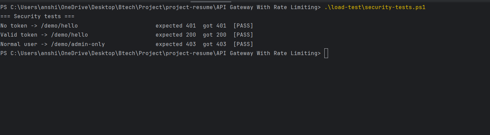
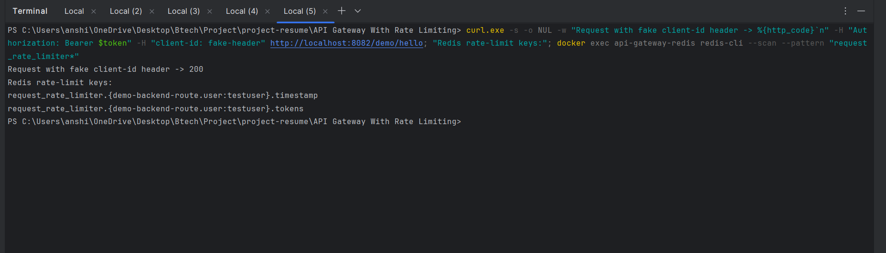
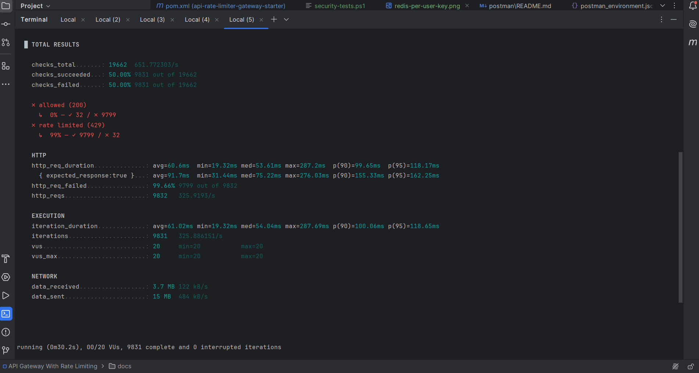

# 🚀 API Gateway & Rate Limiting System (JWT + Keycloak)
## 📌 Overview

A **production-style API Gateway backend** built with **Spring Boot + Spring Cloud Gateway**.
It routes client requests, enforces **per-user rate limiting with Redis**, and secures APIs with **JWT authentication via Keycloak**.

---

## 🏗️ Architecture

```text
Client → API Gateway → Backend Service
           │
           ├── JWT validation (Keycloak)
           ├── Role check (USER / ADMIN)
           ├── Rate limit per JWT user (Redis)
           └── Request logging
```

---

## ⚙️ Features

* 🔁 API routing using Spring Cloud Gateway
* 🚦 Redis-based rate limiting (Token Bucket algorithm)
* 👤 Per-user throttling using the JWT `preferred_username` claim (spoofed headers are ignored)
* 🔐 JWT authentication using Keycloak (OAuth2 Resource Server)
* 🛡️ Role-based access control (USER / ADMIN)
* 📊 Actuator endpoints for monitoring
* 📝 Request logging filter
* 🧪 k6 load test and PowerShell security tests included
* 🐳 Docker-based Redis & Keycloak setup

---

## 🧰 Tech Stack

* Java 21
* Spring Boot, Spring Cloud Gateway
* Spring Security (WebFlux)
* Keycloak (Auth Server)
* Redis
* Docker
* Maven
* k6 (load testing)

---

## 📁 Project Structure

```text
api-rate-limiter-gateway/
│
├── api-gateway-service/        # Gateway (JWT + Rate Limiting)
├── demo-backend-service/       # Sample backend
├── load-test/
│   ├── rate-limit-test.js      # k6 load test
│   └── security-tests.ps1      # 401 / 200 / 403 checks
├── postman/                    # Postman collection & environment
├── docs/                       # Screenshots
├── docker-compose.yml          # Redis
└── pom.xml                     # Parent POM
```

---

## ▶️ How to Run

### 1️⃣ Start Redis

```bash
docker compose up -d
```

### 2️⃣ Start Keycloak

```bash
docker run -d --name keycloak -p 8180:8080 \
-e KEYCLOAK_ADMIN=admin \
-e KEYCLOAK_ADMIN_PASSWORD=admin \
quay.io/keycloak/keycloak:latest start-dev
```

Open `http://localhost:8180`

### 3️⃣ Set up Keycloak

* Create Realm → `api-gateway-realm`
* Create Client → `api-gateway-client`
  * Client Authentication = ON
  * Direct Access Grants = ON
* Copy the **Client Secret** (Clients → api-gateway-client → Credentials)
* Create realm roles: `USER`, `ADMIN`
* Create user `testuser` (password `test123`, Temporary = OFF)

### 4️⃣ Build and run

```bash
mvn clean package -DskipTests
```

Run `DemoBackendApplication`, then `ApiGatewayApplication` (gateway runs on port **8082**).

---

## 🔐 JWT Authentication

### Get a token

```text
POST http://localhost:8180/realms/api-gateway-realm/protocol/openid-connect/token
```

Body (`x-www-form-urlencoded`):

```text
grant_type=password
client_id=api-gateway-client
client_secret=<CLIENT_SECRET>
username=testuser
password=test123
```

### Use the token

```text
Authorization: Bearer <ACCESS_TOKEN>
```

> Access tokens expire after 5 minutes by default. Request a new one when you get 401.

---

## 🌐 API Endpoints

| Endpoint | Access |
|---|---|
| `GET /actuator/health` | Public |
| `GET /demo/hello` | Authenticated user |
| `GET /demo/admin-only` | ADMIN only |

---

## 🚦 Rate Limiting

* Redis-based token bucket
* `replenishRate`: 1 request/sec
* `burstCapacity`: 2
* Key: JWT `preferred_username` (falls back to client IP if there is no principal)

Example: 2 requests allowed instantly, the 3rd returns **429 Too Many Requests**.

The `client-id` header is **not** used for throttling, so changing it cannot bypass the limit.

---

## 🧪 Testing & Results

### Security tests

| Test | Expected | Result |
|---|---|---|
| No token → `/demo/hello` | 401 | ✅ 401 |
| Valid token → `/demo/hello` | 200 | ✅ 200 |
| Normal user → `/demo/admin-only` | 403 | ✅ 403 |
| Expired token → `/demo/hello` | 401 | ✅ 401 |

Run it yourself (keep the secret in an environment variable, never in a file):

```powershell
$env:CLIENT_SECRET = "<your client secret>"
.\load-test\security-tests.ps1
```



### Per-user rate limit key in Redis

A request sent with a fake `client-id: fake-header` still creates the key for the **JWT user**, not for the header value:



### Load test (k6)

Setup: 20 concurrent users, 30 seconds, a **different fake `client-id` header on every request**.

| Metric | Result |
|---|---|
| Total requests | 9,832 |
| Throughput | ~326 req/s |
| Allowed (200) | 32 |
| Rate limited (429) | 9,799 |
| p95 latency (all requests) | 118 ms |
| p95 latency (allowed requests) | 162 ms |



**Why 32?** Burst 2 + 30 s × 1 req/s = 32, so the limiter matches its configuration exactly.
All 20 users share one bucket because the key is the JWT user, not the header.
k6 marks 429 responses as "failed" by default, so `http_req_failed` is high. That is expected here.

**Bug found and fixed:** an earlier build keyed the limit on the `client-id` header, and the same test let **all 17,847 requests through**. After keying on the JWT identity, only 32 pass.

Run it yourself (set the client secret inside the script locally, do not commit it):

```bash
k6 run load-test/rate-limit-test.js
```

> Measured on a local machine (gateway, Redis, Keycloak and k6 on the same laptop), so latency and throughput vary between runs. The 32 allowed requests is the same every time.

---

## 📊 Monitoring

```text
http://localhost:8082/actuator/health
http://localhost:8082/actuator/gateway/routes
```

---

## 📝 Logging

```text
Incoming request → method: GET, path: /demo/hello, client-id: user1
Outgoing response → status: 200
```

---

## 📬 Postman

Import the files in `postman/`, then set:

```text
base_url = http://localhost:8082
token = <JWT>
```

---

## 🎯 Key Learnings

* API Gateway architecture
* JWT authentication (OAuth2 Resource Server)
* Redis token-bucket rate limiting keyed on user identity
* Role-based authorization (401 vs 403)
* Load testing and finding a real security bug with k6
* Multi-module Maven setup

---

## 🔮 Future Improvements

* Single `docker-compose.yml` for the full stack (Redis, Keycloak, gateway, backend)
* Automated integration tests (401 / 403 / 429)
* Circuit breaker (Resilience4j)
* Distributed tracing (Zipkin)
* Prometheus + Grafana metrics

---

## 👨‍💻 Author

**Shubhdeep Varshney**

Email - shubhdeepvarshney02@gmail.com
